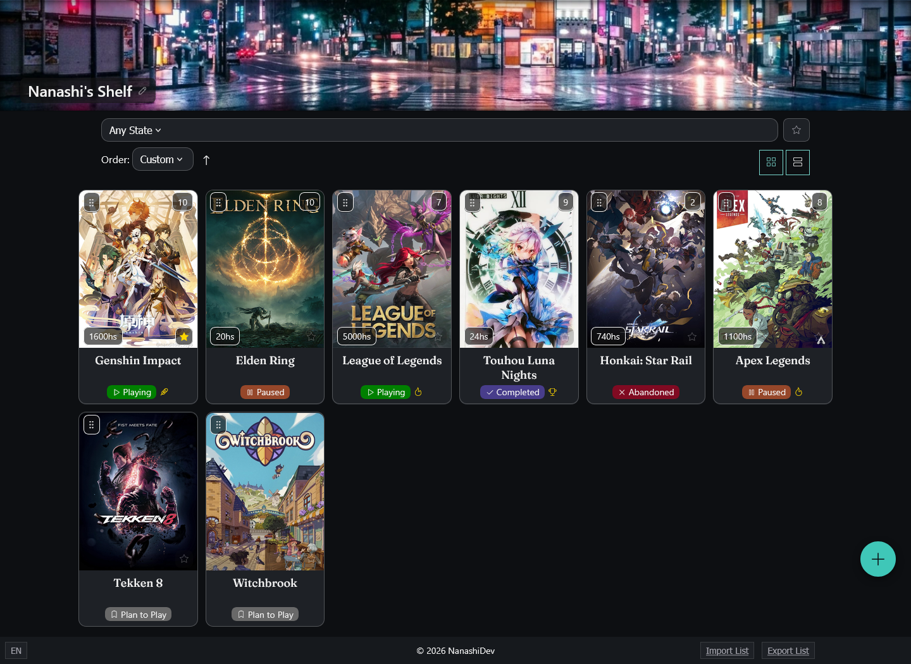

# ShelfTracker

A video game tracker to log what you're playing, what you've already played and what you plan to play, with details like how intensely you play and when you started and finished each game.

**[Live demo](https://shelftrackergg.web.app)**

## Features

- **Play states:** plan to play, playing, completed, paused and abandoned, with modifiers for casual or tryhard play and for 100% completion.
- **Game details:** rating, hours played, start and finish dates, platform, difficulty, revisit chance and a review.
- **Filters and sorting:** filter by state or favorites, and sort by rating, playtime or name.
- **Two views:** grid and list.
- **Custom order:** arrange your shelf with drag and drop (it also works with keyboard).
- **Import and export:** back up your list as a JSON file and restore it anywhere.
- **English and Spanish:** switch languages from the footer.
- **Accounts (optional):** sign up with email and password, verify your email and pick a username. Your shelf is then saved in the cloud.
- **Public shelves:** share a read-only view at `/u/<username>`, or make your shelf private from your account.
- **Local list import:** when you sign up, you can bring over the list you had as a guest.

You can use ShelfTracker as a guest with no account (everything stays in your browser), or create an account to keep your shelf in the cloud.

## Your data

**Guest mode.** Your list lives in your browser's `localStorage`. It stays on your device, and clearing the site's data removes it. Use **Export List** to keep a backup and **Import List** to restore it (importing replaces your current list).

**With an account.** Your list is stored in Firestore and is public by default: anyone with your link can see it. You can make it private from your account dialog. Public shelves are served with `noindex`, so search engines shouldn't list them. To delete your account, email nanashidev774@gmail.com.

## Tech stack

- HTML, CSS and vanilla JavaScript (ES modules), with no frameworks and no build step
- Guest data saved in `localStorage`
- Firebase (Authentication with email and password, Firestore and Hosting), loaded from the CDN only when needed
- [SortableJS](https://sortablejs.github.io/Sortable/) for drag and drop
- [Tabler Icons](https://tabler.io/icons) and Google Fonts ([Fraunces](https://fonts.google.com/specimen/Fraunces) and [Inter](https://fonts.google.com/specimen/Inter))

## Running locally

**Guest mode only:** serve the folder with any static server (`python -m http.server 8000`, `npx serve`, Live Server). Opening `index.html` by double-clicking doesn't work, because browsers block ES modules and `fetch` on `file://`.

**Accounts and public shelves:** use the Firebase emulators, which also handle the `/u/**` rewrite.

1. `npm install`
2. `npx firebase-tools emulators:start --project demo-shelftracker`
3. Open `http://localhost:5000/?emulator`

Without `?emulator`, the app talks to the real project. If you fork this repo, replace `firebaseConfig` in `js/firebase.js` with your own project's.

Run the Firestore rules tests with `npm run test:rules`.

## Roadmap

- A React version of ShelfTracker
- Connection with a game database

## Credits

- Icons by [Tabler Icons](https://tabler.io/icons) (MIT License).
- Drag and drop by [SortableJS](https://github.com/SortableJS/Sortable) (MIT License).
- Fonts: [Fraunces](https://fonts.google.com/specimen/Fraunces) and [Inter](https://fonts.google.com/specimen/Inter), both under the SIL Open Font License.
- Game artwork shown in the demo data, and in any cover URL you add, belongs to its respective owners.

## License

The code is released under the [MIT License](LICENSE). The third-party assets listed above keep their own licenses.
