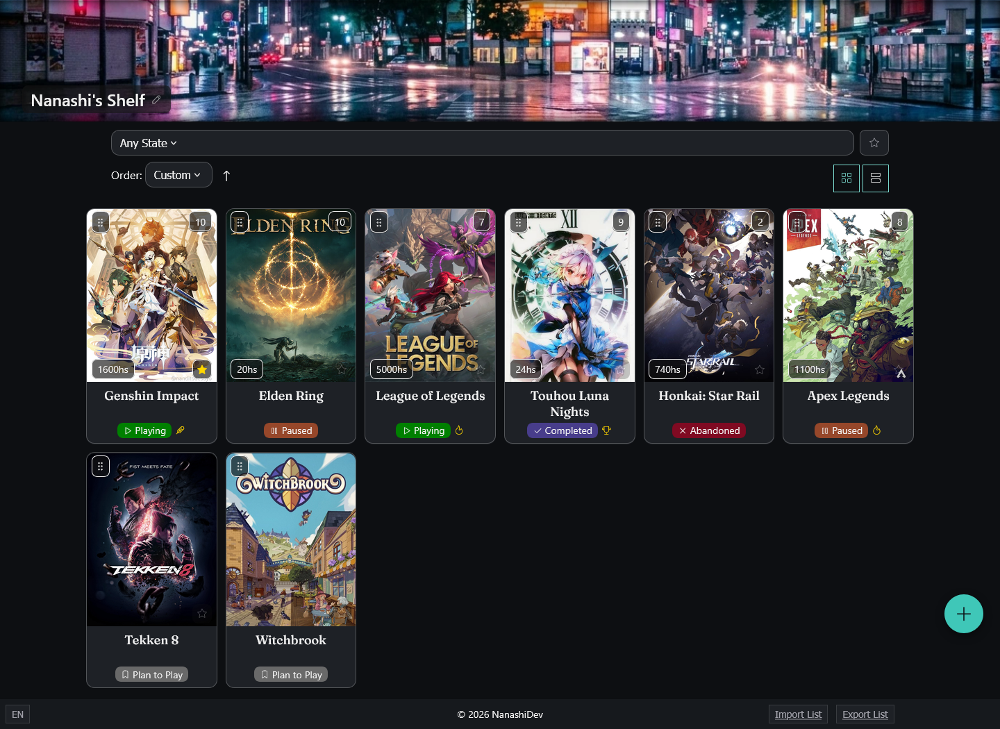

# ShelfTracker

A video game tracker to log what you're playing, what you've already played and what you plan to play, with details like how intensely you play and when you started and finished each game.

**[Live demo](https://IgSilveiras.github.io/shelftracker/)**



## Features

- **Play states:** plan to play, playing, completed, paused and abandoned, with modifiers for casual or tryhard play and for 100% completion.
- **Game details:** rating, hours played, start and finish dates, platform, difficulty, revisit chance and a review.
- **Filters and sorting:** filter by state or favorites, and sort by rating, playtime or name.
- **Two views:** grid and list.
- **Custom order:** arrange your shelf with drag and drop (it also works with keyboard).
- **Import and export:** back up your list as a JSON file and restore it anywhere.
- **English and Spanish:** switch languages from the footer.

No account needed: everything is stored in your browser.

## Your data

Your list lives in your browser's `localStorage`. It stays on your device, and clearing the site's data removes it. Use **Export List** to keep a backup and **Import List** to restore it (importing replaces your current list).

## Tech stack

- HTML, CSS and vanilla JavaScript (ES modules), with no frameworks and no build step
- Data saved in `localStorage`
- [Tabler Icons](https://tabler.io/icons) and Google Fonts ([Fraunces](https://fonts.google.com/specimen/Fraunces) and [Manrope](https://fonts.google.com/specimen/Manrope))

## Running locally

ShelfTracker has no build step, but you can't open `index.html` by double-clicking it. The app uses ES modules and `fetch` (to load the demo games), and browsers block both on `file://` addresses. Serve the folder with a local web server instead.

1. Clone the repository:

   ```bash
   git clone https://github.com/IgSilveiras/shelftracker.git
   cd shelftracker
   ```

2. Start a local server. Pick one:

   ```bash
   # Python 3
   python -m http.server 8000

   # Node.js
   npx serve
   ```

   You can also use the Live Server extension in VS Code.

3. Open the address it shows in your browser. With the Python command above, that's `http://localhost:8000`.

On your first visit the shelf is empty. Use **Load Demo Games** to fill it with sample data.


## Roadmap

- A React version of ShelfTracker
- A fullstack version with a backend and a database

## Credits

- Banner image generated with [Craiyon](https://www.craiyon.com).
- Icons by [Tabler Icons](https://tabler.io/icons) (MIT License).
- Fonts: [Fraunces](https://fonts.google.com/specimen/Fraunces) and [Manrope](https://fonts.google.com/specimen/Manrope), both under the SIL Open Font License.
- Game artwork shown in the demo data, and in any cover URL you add, belongs to its respective owners.

## License

The code is released under the [MIT License](LICENSE). The third-party assets listed above keep their own licenses.
